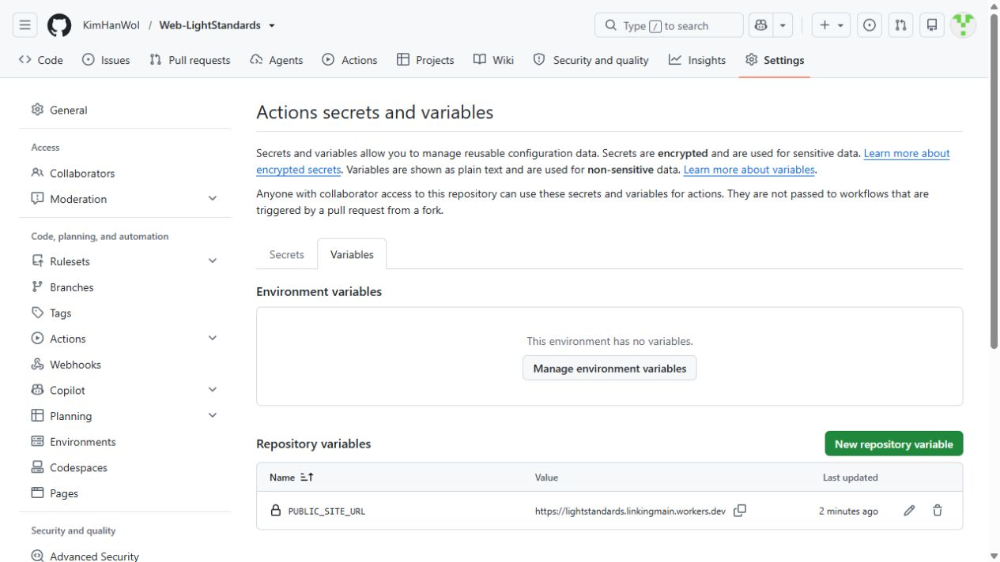

# GitHub 인증과 공개 사이트 URL 연결

현재 저장소는 `KimHanWol/Web-LightStandards`, Cloudflare Worker 이름은 `lightstandards`입니다.

## n8n 원고 저장용 GitHub 인증

[Fine-grained token 생성](https://github.com/settings/personal-access-tokens/new) 화면에서 설정합니다.

| 항목 | 값 |
| --- | --- |
| Token name | `LightStandards n8n` |
| Resource owner | `KimHanWol` |
| Expiration | 90일, 만료 전에 교체 |
| Repository access | Only select repositories |
| Selected repositories | `Web-LightStandards` |
| Repository permissions → Contents | Read and write |
| Metadata | Read-only, 자동 포함 |

발급한 값을 n8n의 Credentials → Add credential → GitHub API에 직접 입력합니다. Credential 이름은 `GitHub - 소소한 기준`, User는 `KimHanWol`, Access Token은 발급한 값, GitHub server는 기본값을 유지합니다.

[Blog - 소소한 기준 [Util] - Publish Approved](https://qkqk9898.app.n8n.cloud/workflow/yihoqk3fpBOC8P04)의 `Commit Approved Article` 노드에서 해당 credential을 선택하고 저장합니다. 이 노드는 승인 원고 JSON을 `content/inbox/` 아래에 저장합니다. Workflows 편집이나 계정 관리 권한은 사용하지 않습니다.

근거: [GitHub 토큰 생성](https://docs.github.com/en/authentication/keeping-your-account-and-data-secure/managing-your-personal-access-tokens), [파일 작성 API의 Contents 권한](https://docs.github.com/en/rest/repos/contents#create-or-update-file-contents), [n8n GitHub credential](https://docs.n8n.io/integrations/builtin/credentials/github/).

## 기본 공개 주소 만들기

2026-10-14 계정의 `workers.dev` 하위 도메인 `linkingmain`을 실제 API로 확인하고, 준비된 사이트를 배포했습니다. 현재 기본 확인용 주소는 `https://lightstandards.linkingmain.workers.dev`입니다. 홈페이지·문의·robots.txt·사이트맵의 HTTP 200 응답과 실제 주소 반영을 확인했습니다.

Cloudflare Worker `lightstandards`의 배포 버전은 `becb18cd-741e-4c0a-9b15-75fa8d5757bc`입니다. 검색 노출은 준비 전 상태로 유지했습니다(`noindex`, robots.txt의 `Disallow: /`). 승인된 게시 글은 아직 0개이며, 테스트 원고는 게시하지 않았습니다. 사용자는 정식 도메인을 나중에 직접 구매하기로 했습니다. `lightstandards.com`은 같은 날 Verisign RDAP에서 이미 등록된 도메인임을 확인했습니다.

로컬 인증된 Wrangler로 미리보기 배포를 실행하는 순서입니다. 현재 사이트는 준비 전 noindex 상태이며 테스트 원고는 게시 대상에서 제외됩니다.

```powershell
cd D:\Workspace\Blog
npm run build
npx wrangler deploy
```

위 명령은 이후 로컬 확인용 배포에 사용할 수 있습니다. 정식 운영 설정을 마치기 전에는 빌드에 `PUBLIC_SITE_URL=https://lightstandards.linkingmain.workers.dev`, `PUBLIC_SITE_READY=false`를 지정합니다. [Workers 기본 주소 규칙](https://developers.cloudflare.com/workers/configuration/routing/workers-dev/), [정적 배포 안내](https://docs.astro.build/en/guides/deploy/cloudflare/).

## 같은 공개 주소를 두 곳에 입력

| 설정 장소 | 항목 | 값 |
| --- | --- | --- |
| GitHub 저장소 Settings → Secrets and variables → Actions → Variables | `PUBLIC_SITE_URL` | 실제 공개 HTTPS 주소, 글 경로 제외 |
| n8n Publish Approved → Configuration | `site_url` | 위와 같은 실제 공개 HTTPS 주소 |
| n8n Publish Approved → Configuration | `repo_owner` | `KimHanWol`, 이미 설정됨 |
| n8n Publish Approved → Configuration | `repo_name` | `Web-LightStandards`, 이미 설정됨 |

현재 `PUBLIC_SITE_URL`과 n8n `site_url`에 기본 확인용 주소를 저장했습니다. GitHub credential `GitHub - 소소한 기준`도 게시 노드에 연결됐습니다. 자동 게시·유료 생성 일정은 활성화하지 않았습니다.



[GitHub Actions 설정](https://github.com/KimHanWol/Web-LightStandards/settings/secrets/actions)에서 Cloudflare 배포에는 기존 `CLOUDFLARE_API_TOKEN`, `CLOUDFLARE_ACCOUNT_ID` secret을 사용합니다. GitHub PAT는 n8n credential에 저장합니다.

공개 주소와 정책 문구를 반영한 뒤 `config/publication.json`의 `reviewed=true`를 적용하고 GitHub variable `SITE_PUBLISH_ENABLED=true`로 자동 배포를 켭니다. Actions의 `Publish LightStandards`을 수동 실행해 성공을 확인한 다음 n8n 발행 Configuration의 `enabled=true`를 적용합니다. 일정을 켜기 전 실제 생성용 검색 데이터와 검토 출처 공급도 준비합니다.

나중에 실제 도메인을 연결할 때는 Cloudflare의 해당 Worker → Settings → Domains & Routes → Add → Custom Domain에 입력합니다. Cloudflare에서 활성화한 도메인 zone이 필요합니다. 최종 도메인으로 바꾸면 `PUBLIC_SITE_URL`과 `site_url`도 함께 변경합니다. [커스텀 도메인 절차](https://developers.cloudflare.com/workers/configuration/routing/custom-domains/).
