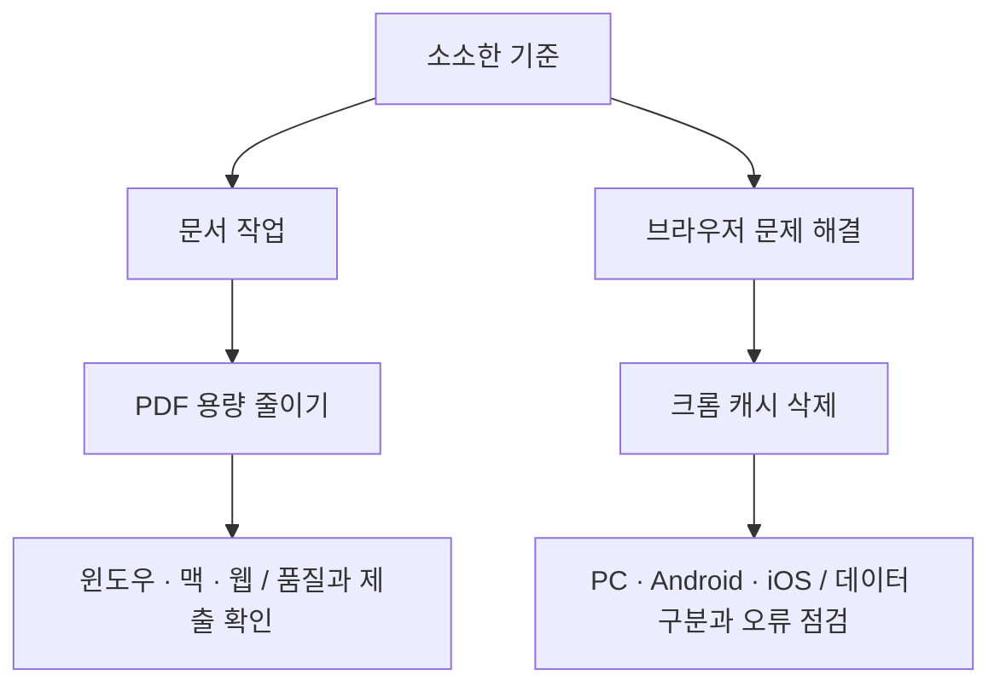

# 카테고리와 주제 맵

운영용 스냅샷은 `config/topic-map.json`, n8n의 실시간 정보는 Articles Data Table의 `topic_map_json`과 행 상태입니다. 핵심 질문·적용 범위·다룬 내용·제외 범위·키워드 별칭을 기록합니다. 아직 검토하지 않은 후보를 발행 가능한 주제라고 표시하지 않습니다.

분류는 실제 글에서 시작한 것이며 블로그의 주제를 이 두 가지로 고정한 것이 아닙니다. 새 글이 생기면 해당 질문과 범위에 맞는 분류를 추가합니다.

## 새 주제를 검토하는 순서

1. 월간 키워드 자료에서 후보를 고르고 실제 검색 의도를 기록합니다. 자료가 없으면 검색량·경쟁도·수익성은 미확인으로 둡니다.
2. 모든 카테고리의 기존 핵심 질문·범위와 비교합니다. 단순 제목 변경이나 문장 재작성은 새 주제로 취급하지 않습니다.
3. 이미 다룬 답이라면 기존 글을 갱신하거나 해당 절로 연결합니다. 다른 도구·환경·해결 질문이라 독립적인 답이 필요하면 그 차이를 기록합니다.
4. 검토한 근거가 충분한 후보만 Articles의 ready 상태로 올립니다. 후보마다 맵을 함께 기록하면 다음 생성에서 중복을 확인할 수 있습니다.

| 후보 예시 | 기존 글과의 관계 | 결정 |
| --- | --- | --- |
| 맥 PDF 용량 줄이기 | PDF 글의 미리보기 절에서 이미 설명 | 독립 글보다 기존 글 보강 |
| Chrome 캐시 지우기 | 캐시 삭제 글의 별칭·같은 질문 | 중복 보류 |
| Safari 캐시 삭제 | Chrome 글의 제외 범위·다른 도구 | 키워드·근거 검토 후 후보로 판단 |
| Chrome 전체 초기화 | 캐시 글에 차이는 있으나 자세한 독립 절차는 없음 | 독립적인 문제 해결 의도가 있는지 먼저 검토 |

위 예시는 실제 검색량이 확인된 추천 키워드가 아닙니다.

## 현재 구현 범위

- 같은 articleId·intentKey는 기존 검사에서 막습니다.
- 공백·구두점·대소문자를 정리한 키워드, 등록한 별칭, 핵심 질문이 같으면 카테고리와 관계없이 생성을 보류합니다.
- 표현이 다른 의미상 중복은 기존 맵을 원고 작성 입력에 함께 넣어 모델이 검토하도록 합니다. 이 판단은 완전한 의미 중복 탐지나 독립 검증을 보장하지 않습니다.
- 맵 형식이 깨져 있으면 해당 후보를 생성하지 않습니다. 실제 상태·카테고리는 맵 안의 오래된 값보다 Data Table 행 값을 우선합니다.
- 준비된 근거와 기존 글 제목·맵만 사용합니다. 매시간 유료 키워드 검색을 추가하지 않습니다.

## 실제 캡처 이미지

확보 가능한 실제 화면이나 공식 안내의 필요한 짧은 구간을 우선 사용합니다. 다른 사이트 사진·원고를 통째로 가져오지 않고 개인 정보가 없는 구간만 캡처하며 출처와 캡처 종류를 표시합니다. 앱 화면을 확보하지 못했다면 도움말 캡처를 앱 화면이라고 표시하지 않습니다.

현재는 검토한 캡처를 로컬 WebP로 보관하고, 파일 내용 SHA-256·제한된 경로·실제 크기·원고 근거와 일치하는 출처를 검사합니다. 캡처를 해당 절에 배치하고 생성 이미지와 다른 캡션을 표시합니다. n8n Cloud에서 사용자 기기의 화면을 자동 촬영하는 기능은 구현한 것이 아닙니다. 캡처 자료는 편집 단계에서 확보·검토한 뒤 첨부합니다.
