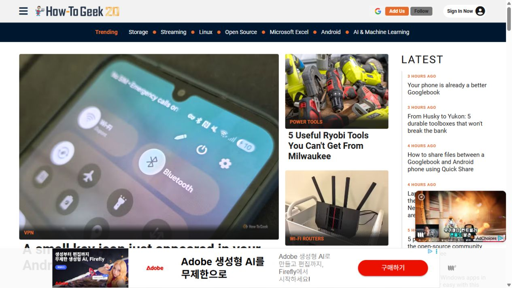
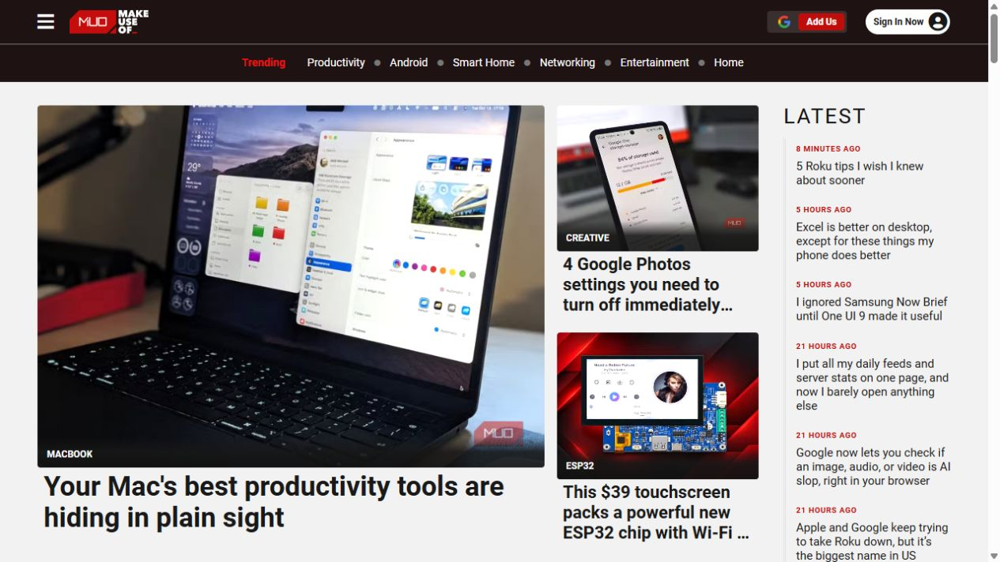
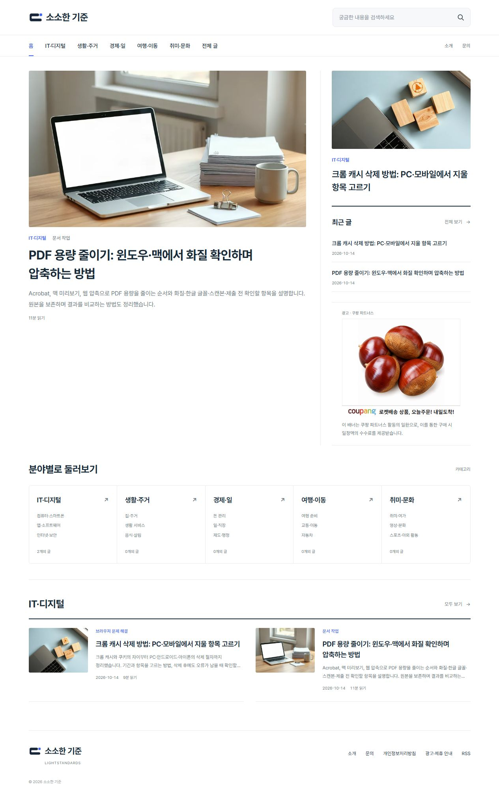
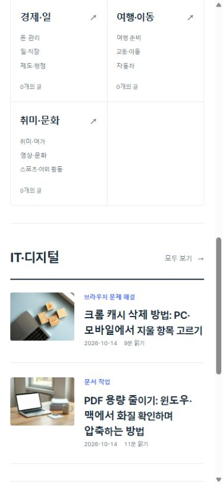

# 광고 종류·위치 조사와 쿠팡 배너 배치

확인일: 2026-10-15. 현재 홈페이지 및 실제 참고 사이트를 브라우저에서 확인했습니다. 광고는 지역·시간·동의 상태에 따라 달라지므로 한 번의 화면에 보인 형태와 운영사 공개 규격을 구분합니다. 수익·CTR·전환율은 측정한 값이 없습니다.

## 참고 사이트에서 확인한 요소

| 참고 출처 | 광고·수익화 종류 | 확인한 위치·요소 | 확인 범위 |
| --- | --- | --- | --- |
| [How-To Geek 홈](https://www.howtogeek.com/) | 넓은 가로 디스플레이, 동영상 광고 | 화면 하단에 겹쳐 붙는 가로 배너, 오른쪽 아래 작은 영상 플레이어 | 이번 실제 화면·DOM에서 970×100 배너와 약 227×128 영상 광고 iframe 확인. 이를 AdSense라고 단정하지 않음 |
| [MakeUseOf 홈](https://www.makeuseof.com/) | 가로 광고 등 | 이전 2026-10-14 참고 화면에는 하단 가로 광고. 이번 2026-10-15 샘플에는 광고가 미표시 | 다른 방문 시점의 광고를 현재 모든 방문자의 고정 배치라고 주장하지 않음 |
| [Valnet 공식 광고 규격](https://adspecs.valnetinc.com/) | 리더보드·MREC·세로 광고·아웃스트림 영상·스폰서 콘텐츠 | 728×90은 기사·섹션 상단, 300×250은 콘텐츠 내, 300×600은 사이드바. 영상은 독립 광고 플레이어 | 운영사 상품 설명. 이 모든 슬롯이 두 사이트의 모든 화면에 동시에 표시된다는 뜻은 아님 |
| [WPBeginner 웹사이트 가이드](https://www.wpbeginner.com/guides/) | 문맥형 제휴 텍스트 링크·오퍼 CTA·링크된 이미지 | 호스팅 설명 문단의 Bluehost 등 링크, 해당 절 안의 별도 오퍼 링크와 배너 이미지. 인근에 수수료 설명 | 이번 실제 DOM에서 `/refer/` 링크, CTA, 이미지 링크와 수수료 고지를 확인. 서비스 선택 설명과 연결된 배치 |
| [Google 인피드 안내](https://support.google.com/adsense/answer/9189557?hl=en) | 목록형 네이티브 광고 | 기사·상품 피드의 항목 사이 | 형식의 공식 사용처. 위 참고 사이트가 이 AdSense 상품을 쓰는지와는 별개 |
| [Google 콘텐츠 내 광고 안내](https://support.google.com/adsense/answer/9189562?hl=en) | 콘텐츠 내 네이티브 광고 | 원고 문단 사이 | 공식 형식 설명 |

우리 홈페이지의 원래 가로 광고 래퍼는 폭 836px·높이 약 186px였고, 주요 글 끝과 분야 디렉터리 사이에 독립된 띠로 놓였습니다(915px 창에서 측정). 배너 그림은 728×90이지만 광고 라벨·수수료 안내·안쪽 여백까지 합쳐 탐색 흐름을 끊는 공간이 생겼습니다. 이는 측정된 레이아웃이며 광고 효율 저하를 입증한 통계는 아닙니다.

## 우리 사이트에 적용한 배치와 추가 계획

| 화면·위치 | 종류·규격 | 상태 | 필요한 자료 |
| --- | --- | --- | --- |
| 홈 PC, 최근 글 목록 아래 오른쪽 영역 | 쿠팡 상품 캐러셀 300×250 | 기존 코드 1038387 재사용해 적용 | 추가 코드·결제 없음 |
| 홈 모바일·태블릿, 첫 분야의 글 묶음이 끝난 뒤 | 쿠팡 300×250, 넓은 태블릿에서는 기존 728×90 | 기존 반응형 코드 재사용. PC 홈 배너와 동시에 보이지 않음 | 추가 코드·결제 없음 |
| 기사 PC, 완결된 본문 절 사이·하단 | 쿠팡 728×90 | 기존 위치·코드 1038394 유지 | 추가 코드·결제 없음 |
| 기사 PC 오른쪽 | 쿠팡 160×600 | 기존 코드 1038395 유지 | 추가 코드·결제 없음 |
| 기사 모바일, 본문 절 사이·하단 | 쿠팡 300×250 | 기존 반응형 코드 유지 | 추가 코드·결제 없음 |
| 기사 설명 절이 끝나는 자리 | AdSense 반응형 디스플레이 또는 콘텐츠 내 광고 | 추가 연결 계획. 아직 새 광고를 활성화하지 않음 | 사이트 승인 상태 확인, 발급된 광고 코드의 client·slot. 콘텐츠 내 형식은 해당 단위의 전체 코드 |
| 홈·카테고리·전체 글에서 충분한 목록 항목 사이 | AdSense 인피드 | 글이 쌓인 뒤 적용할 계획. 현재 글 2편 목록에 추가하지 않음 | 승인된 인피드 광고 코드(client·slot·layout-key 등 실제 발급 속성) |
| 상품·서비스를 설명·비교하는 해당 절 | 단일 상품 카드·문맥형 쿠팡 링크 | 기존 affiliates 필드로 텍스트/링크 표시 가능. 현재 두 글에는 삽입하지 않음 | 해당 상품의 실제 파트너스 링크, 확인한 상품 정보와 사용할 이미지. 관련성 있는 글에만 검토 후 사용 |

이 표의 AdSense와 문맥형 상품 카드 행은 설계·준비 항목입니다. 아직 발행된 새로운 광고 종류인 것처럼 보고하지 않습니다. 위 플랫폼 광고 단위 이름을 쿠팡 캐러셀 이름으로 혼용하지 않습니다.

하단 고정 앵커와 작은 영상 플레이어는 참고 사이트에서 확인했지만 지금 사이트에는 추가하지 않습니다. 영상 광고는 현재 원고·쿠팡 코드만으로 운영할 수 있는 형식이 아니며 별도 광고사업자·영상 구현이 필요합니다. 광고 숫자보다 공간·독자 의도·실제 결과에 맞춰 다음 단계를 결정합니다.

[Google 배치 지침](https://support.google.com/adsense/answer/1282097?hl=en)에 따라 광고를 메뉴·다운로드 등 기능 요소와 혼동하게 두지 않는 원칙을 참고했습니다. 이는 우리 사이트의 AdSense 승인이나 쿠팡 정책 준수를 인증하는 검사가 아닙니다. 배너에는 광고 라벨과 배너에 관한 수수료 안내를 유지합니다.

| Before | After | Why |
| --- | --- | --- |
| 주요 글과 분야 탐색 사이의 넓은 가로 띠 | PC 오른쪽 300×250, 모바일은 첫 글 묶음 뒤 | 카테고리를 찾는 동선을 끊지 않고 역할에 맞는 크기 사용 |
| 같은 캐러셀이 여러 위치에 반복되는 구조만 설명 | 현재 가로·정사각형에 가까운 직사각형·세로형과 이후 문맥형·목록형 광고를 분리 | 크기 변화와 광고 상품·수익 모델 다양화를 구분 |

## 적용·공개 검증

커밋 7d9b8c1d18158ccb8e04290ce83fbd8d0a6cee78, GitHub Actions 38591536868 성공. 기존 테스트 19개 및 빌드 통과. PC 1280px에서는 home-sidebar의 실제 iframe·loaded 상태·300×250 프레임을 확인했으며 home-middle 래퍼의 폭은 0이고 새 iframe 요청이 없었습니다. 모바일 390×844에서는 home-middle 300×250이 loaded이고 숨긴 PC 슬롯에는 iframe이 없었습니다. 900px 경계에서는 모바일·태블릿 위치만, 901px에서는 사이드 위치만 표시되고 프레임 폭 300px가 확보됩니다. 모든 검토 크기에서 본문 가로 넘침이 없습니다. 임시 뷰포트를 복원하고 새 홈을 열어 두었습니다. 실제 초기 광고 로드를 기다린 뒤에 상태를 확인했으며 로딩 중 빈 화면을 광고 송출 성공으로 보고하지 않았습니다.

새 유료 생성·광고 계정 연결은 없고 기존 쿠팡 ID와 추적 코드만 재사용했습니다. 현재 세 규격 모두 같은 쿠팡 캐러셀 상품이며, AdSense·문맥형 제휴 링크 추가 계획과 구분합니다.

