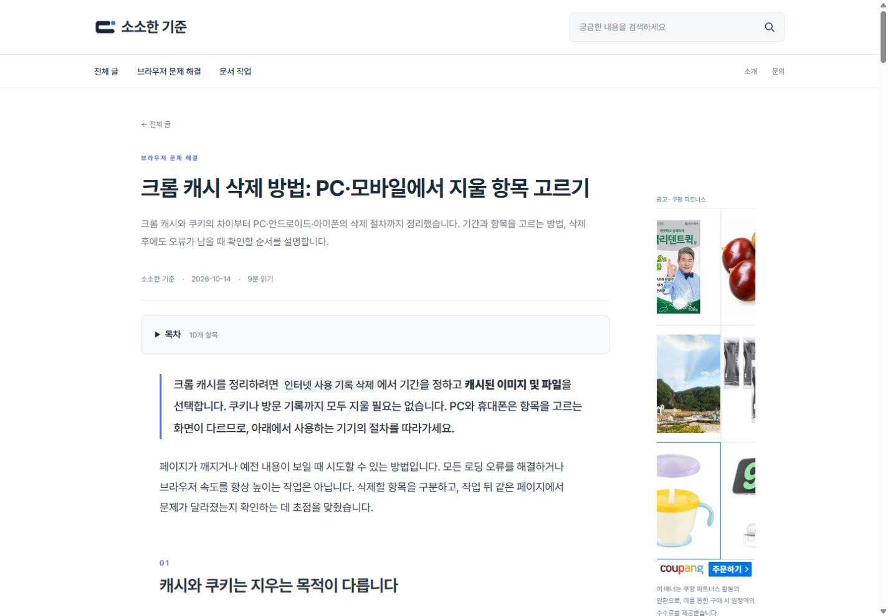
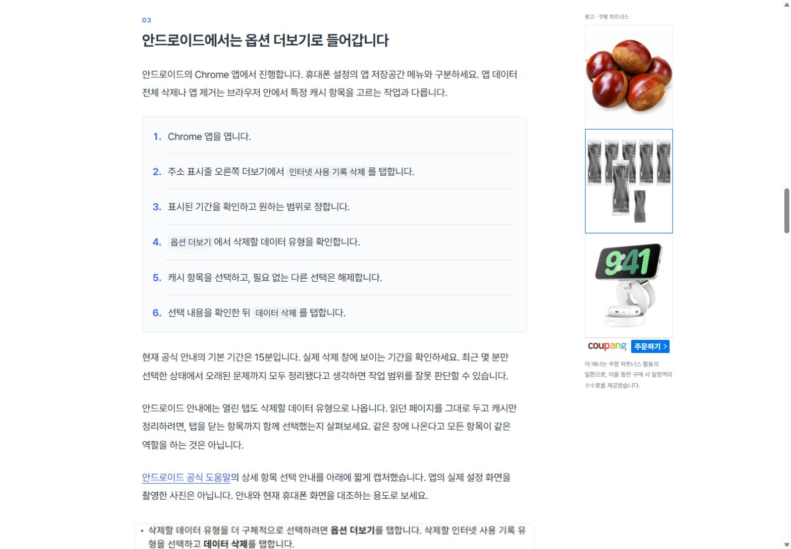
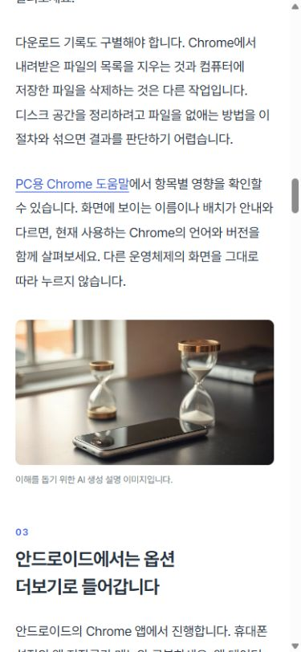
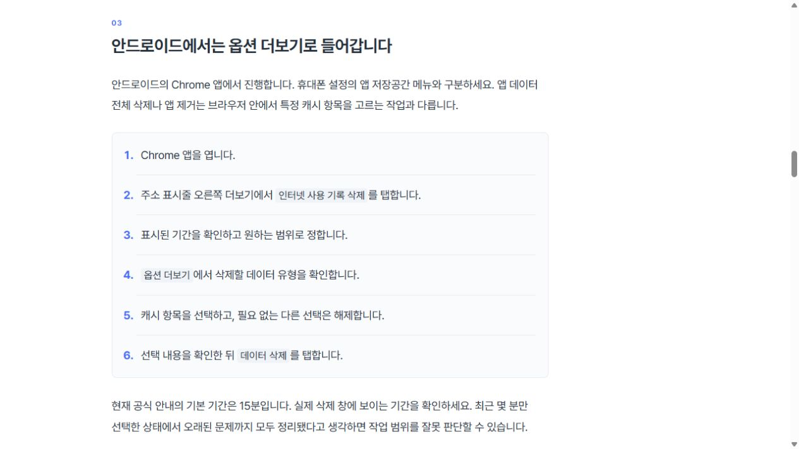

# 추가 원고 발행과 주제 맵 검증

대상: 크롬 캐시 삭제 방법: PC·모바일에서 지울 항목 고르기

발행 대상 주소: https://lightstandards.linkingmain.workers.dev/notes/chrome-cache-clear-20261014/

## 작성·편집·이미지

Google 공식 안내 8건을 2026-10-14 확인했습니다. 주제는 사용자가 요청한 추가 원고를 위해 선택했으며 검색량·경쟁도·수익성을 검증한 키워드라는 뜻은 아닙니다.

실제 OpenAI 생성은 n8n 2372입니다. 원고 1,556자로 길이 검사에서 보류됐고 비용 추정 $0.004696이 기록됐습니다. 재결제하지 않고 원문을 `raw-model-draft.md`로 보존한 다음, 공식 근거와 절차·예외를 대조해 6,131자의 `edited-body.md`로 편집했습니다. 설명 문단의 최대 길이는 164자입니다. 이 최종 원고 전체가 한 번의 OpenAI 호출에서 그대로 나온 것은 아닙니다.

초기 모델이 제안한 앱 화면·인포그래픽 생성 프롬프트는 사용하지 않았습니다. 편집 단계에서 텍스트·실제 UI를 만들지 않는 설명 장면으로 고쳤습니다.

- Android·iOS 공식 도움말의 필요한 짧은 구간 2장을 실제 브라우저에서 캡처하고 검토했습니다. 앱 설정 화면을 촬영한 것이라고 주장하지 않았습니다. 전체 도움말이나 개인 정보 영역을 게재하지 않았습니다.
- 확인된 출처 링크·캡션·절 제목·실제 크기를 기록하고 WebP 파일을 내용 SHA-256 이름으로 저장했습니다. 가져오기 과정에서 경로·파일 해시·포맷·크기를 검사합니다.
- 실제 fal 요청으로 설명 사진 3장을 생성했습니다. 2373에서 첫 이미지 요청, 2375·2376에서 결과 확인과 다음 요청, 2377에서 마지막 결과 확인. OpenAI 재호출은 하지 않았습니다.
- 최종 그림 5장은 캡처 2장·AI 생성 설명 이미지 3장입니다. 대표 이미지는 설명 사진으로 배치하고 공식 캡처는 각 기기 설명에 붙였습니다.
- 누적 API 추정 비용 $0.013696. 제공사 청구서 대조 전 금액이며 편집 노동·구독료는 포함하지 않습니다.

2373·2374·2378은 기존 실제 실행 결과와 검토한 편집 값을 사용한 선택적 단계 실행입니다. OpenAI 노드는 저장된 결과로 재현하고 다시 결제하지 않았습니다. Save Draft와 해당 fal 요청은 실제 노드를 실행했습니다. 2374는 기존 PDF 글의 주제 맵만 저장했고 기존 published 상태·비용·원고를 유지했습니다.

## 주제 맵

`config/topic-map.json`에 현재 두 실제 글의 카테고리·핵심 질문·범위·다룬 내용·제외 범위·별칭을 정리했습니다. 운영용 Data Table에는 `topic_map_json` 필드를 추가하고 두 실제 행에 저장했습니다. 자세한 기준은 `n8n/TOPIC_MAP.md`입니다.

같은 식별자·검색 의도 키는 기존처럼 차단합니다. 카테고리가 달라도 등록한 키워드 별칭·핵심 질문이 정규화 후 같으면 선택을 보류합니다. 기존 맵을 작성 프롬프트에 전달해 표현이 다른 의미상 중복도 검토하도록 했습니다. 이 모델 판단을 완전한 의미 중복 탐지라고 주장하지 않습니다.

캡처는 현재 편집 단계에서 확보해 검토하는 방식입니다. n8n Cloud가 사용자의 Chrome 화면을 자동 촬영하는 기능은 구현하지 않았습니다.

## 코드·발행 검증

캡처 출처·제한된 경로 검사, 별칭 중복 보류·맵의 적용 범위 전달 테스트를 추가했습니다. 총 18개 테스트 통과. 코드·캡처 자산 배포 57a732d, Actions 38514698473 성공.

현재 원고 revision 2를 사용자 추가 발행 요청에 따라 승인한 실행 2379가 성공했습니다. GitHub 작성 실행 2380이 실제 커밋 f1e0ad2fbaf793a6315ec0920bc3c53937d1a58b을 작성했습니다. Actions 38515198609에서 테스트·가져오기·빌드·원본 보관·Cloudflare 배포가 성공했습니다. 실행 2381이 공개 manifest의 revision 2를 확인해 Data Table 상태를 published로 저장했습니다.

https://github.com/KimHanWol/Web-LightStandards/actions/runs/38515198609

- 글·사진 5개 모두 HTTP 200. 실제 그림 구성은 생성 3장·캡처 2장. 이미지 합계 123,928바이트.
- 홈페이지 목록에 새 글 링크 표시. 공개 manifest에 기존 PDF revision 3과 Chrome revision 2 모두 포함.
- PC 1440×1000: 가로 넘침 없음, 본문 18px, 오른쪽 배너 표시. 캡처 2개 모두 로드됨.
- 모바일 390×844: 가로 넘침 없음, 본문 17px, 표의 세로 구성, 사이드 배너 숨김. 짧은 원본 캡처는 출처에서 현재 공식 안내를 열어 확인할 수 있으며 원본 이미지 보기 링크도 추가했습니다.
- 브라우저 임시 뷰포트 복원, 원고·배포용 탭은 새 글을 표시하도록 정리했습니다.

본체 paid_enabled=false·기존 월 예산 $7·일 제한 2로 복원했고, 전체 워크플로 일정은 비활성입니다. 이번 한 편의 수동 실행만 임시로 허용했습니다.

## 사용자 캡처 제외 요청 반영

2026-10-14 사용자가 도움말 문장 캡처가 불필요하다고 판단하여 두 캡처를 제거했습니다. 기존 설명 이미지 3장은 유지하고 캡처를 가리키던 본문 안내도 출처 안내로 바꾼 최종 승인 revision 4입니다. 신규 자동 원고의 5장 기준을 낮추지 않고 해당 승인 원고의 imageCountException에 사유를 기록했습니다. 새 이미지 유료 요청은 없습니다. n8n 작성 프롬프트·주제 맵 지침·AGENTS.md에도 문장 캡처 제외와 실제 조작 화면만 사용한다는 기준을 반영했습니다. 로컬 테스트 19개 및 빌드 통과.

최종 공개 manifest는 Chrome revision 4, PDF revision 3입니다. GitHub Actions 38563004254에서 배포 성공. n8n 실행 2382는 사용자 요청으로 검토한 revision 4를 Select Publication의 입력으로 고정한 선택 실행이며, 공개 manifest 확인·revision 대조·Data Table 저장은 실제 노드를 실행했습니다. 행 상태 published·approved_revision=4·images_json 3장·본문 6,110자, 누적 비용 $0.013696 유지. 임시 저장 매핑을 원복했습니다. 공개 화면에서 캡처 0장·그림 3장·가로 넘침 없음 확인. PC 우측 배너의 기존 sticky 배치를 유지하며 넓이·높이가 충분하지 않은 창에서는 기존 반응형 조건을 따릅니다.

