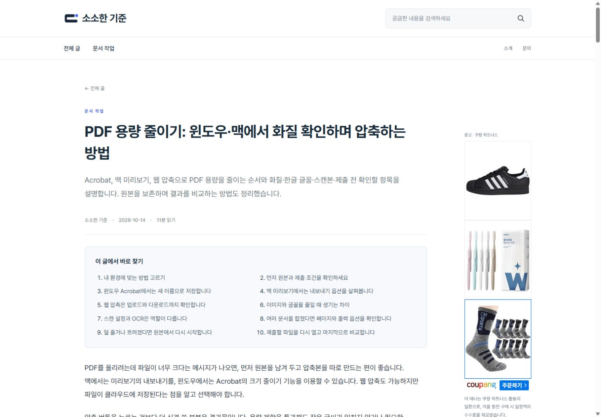
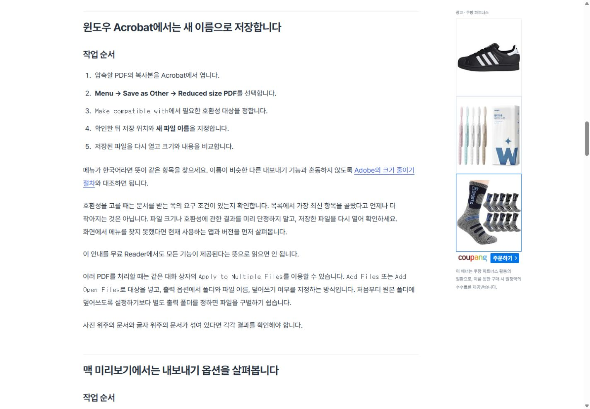
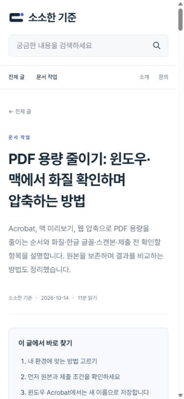
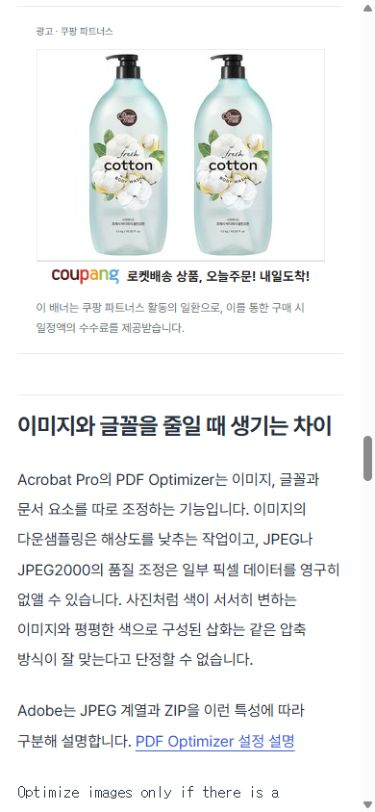

# 첫 원고 발행 검증 — 2026-10-14

발행 주소: https://lightstandards.linkingmain.workers.dev/notes/pdf-compression-20261014/

원고: **PDF 용량 줄이기: 윈도우·맥에서 화질 확인하며 압축하는 방법** / revision 3. 사용자가 수정 후 발행까지 검증하도록 요청했고, 해당 revision을 승인했습니다. 사이트에 실제로 게시한 글은 한 편입니다. 기존 test-domain-hosting 원고는 제외했습니다.

## 글 구성 참고

Adobe의 한국어 PDF 안내 글에서 목차·번호 매긴 작업 순서·중간 이미지 구성을, Zapier의 정보 글에서 환경별 구분과 비교 구성을 참고했습니다. 문장이나 이미지, 고유 디자인을 복제하지 않았습니다. 조회수 순위나 검색량을 검증한 사례라는 뜻은 아닙니다.

- https://www.adobe.com/kr/acrobat/roc/blog/compress-pdf-to-300kb.html
- https://zapier.com/blog/best-screen-recording-software/

| Before | After | Why |
| --- | --- | --- |
| 긴 설명 문단 중심 | 약 210자 이하의 설명 문단, 15개 순서 항목, 비교표 | 필요한 순서와 설명을 따로 찾기 쉽게 구성 |
| 이동할 목차 없음 | 실제 H2와 연결된 목차 10개 | 긴 글에서 필요한 부분으로 바로 이동 |
| 두 장만 표시되는 이미지 제한 | 검토한 사진 5장을 본문에 분산 | 문단 사이에 시각적인 구간을 만들고 모두 실제 표시 |
| PNG를 그대로 게시 | WebP로 압축하고 첫 이미지 외에는 지연 로드 | 발행 이미지 5장 합계 134,500바이트 |
| UTC 날짜를 잘라 표시 | Asia/Seoul 기준 날짜 표시 | 실제 발행일 2026-10-14과 일치 |
| 코드 커밋까지만 확인 가능 | 공개 revision 확인 후 n8n published 저장 | GitHub 저장 성공과 실제 홈페이지 게시 성공을 구분 |

## 실제 발행 흐름

- 사진 추가: n8n 2336 → 이미지 확인 2337, 2338, 2339. 서로 다른 장면 3장을 실제 fal API로 추가했고 기존 검토 사진 2장과 합쳤습니다. OpenAI는 다시 호출하지 않았습니다.
- 현재 revision 승인: n8n 2340.
- 실제 GitHub 파일 작성: n8n 2341, 커밋 1866769283f7d15446ccb4b368a7ee6341072acf.
- GitHub Actions: https://github.com/KimHanWol/Web-LightStandards/actions/runs/38439121446 — 성공.
- Actions에서 원고·이미지 가져오기, 테스트, 빌드, 원본 보관, Cloudflare 배포가 모두 성공했습니다. 보관 커밋 f8d6132.
- 공개 manifest 확인과 상태 변경: n8n 2342 — 성공. Data Table의 상태 published, revision 3.
- n8n 워크플로 일정은 비활성 상태이며 본체 paid_enabled=false입니다. GitHub의 SITE_PUBLISH_ENABLED=true는 실제 저장된 승인 콘텐츠의 자동 배포에 사용됩니다.

## 공개 페이지 확인

본문은 백엔드 검사 방식으로 7,092자, 실제 Markdown 렌더링 텍스트 기준으로 7,050자입니다. 본문·홈 목록·사진 5개 모두 HTTP 200을 확인했습니다. publication.json이 해당 articleId의 revision 3을 반환했습니다.

- 본문 사진 5장, 비교표 1개, 목차 링크 10개.
- PC 1440×1000: 가로 넘침 없음, 실제 쿠팡 상품 배너 표시, 오른쪽 sidebar sticky.
- 목차 클릭: section-3의 화면 위 위치 28px, 따라오는 배너의 위 위치 24px.
- 모바일 390×844: 가로 넘침 없음, 사이드 배너 숨김, 본문 쿠팡 iframe 300×250.
- 첫 생성부터 보강·사진 교체·추가까지 누적 API 추정 비용 약 $0.03396. 제공사 청구서와 대조한 금액은 아니며 정상 한 번 생성의 단가를 의미하지 않습니다.
- 검색량·키워드 수익성·AdSense 승인과 광고 전환 수익은 이번 발행 검증 범위에 포함되지 않습니다.

