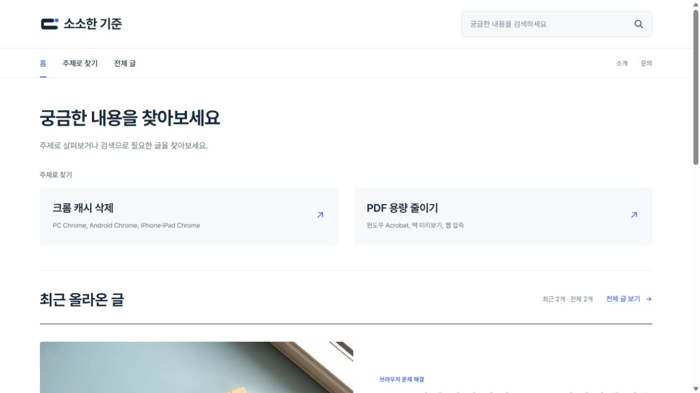
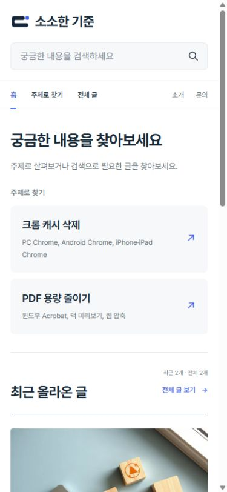

# 홈페이지 탐색 개선

홈 상단에 발행 날짜와 무관하게 확인할 수 있는 주제 목록을 추가하고, 최근 글(기본 최대 6편)과 전체 글 보기를 나눴습니다. 상단 메뉴는 홈·주제로 찾기·전체 글입니다. 기존 원고의 카테고리·승인 revision·본문·광고 설정은 변경하지 않았습니다.

주제는 공개된 실제 글과 기존 주제 맵에서 가져옵니다. 현재는 Chrome 캐시 삭제와 PDF 용량 줄이기입니다. 맵에 없는 새 발행 글도 제목·설명을 이용해 표시하며 발행일로 주제 우선순위를 결정하지 않습니다. 실제 조회 데이터가 없는 인기 순위나 추천 성과를 표시하지 않습니다. 주제 맵의 키워드 별칭과 범위를 검색 대상에 포함했습니다.

Emil 디자인 스킬의 가독성·터치 영역·접근성 기준을 참고했습니다.

| Before | After | Why |
| --- | --- | --- |
| 최신순 목록이 홈의 유일한 탐색 경로 | 주제 목록·최근 글·전체 글 | 기존 글을 발행일 외의 경로로 찾도록 |
| 세부 카테고리가 상단 메뉴에 표시 | 홈·주제로 찾기·전체 글 | 기존 두 글의 분야를 사이트 전체 범위로 고정하지 않도록 |

빌드 성공. 커밋 4460ef15adfd361f5561c41a33be55c20f96752f의 GitHub Actions 38570744166 배포 성공. 공개 사이트에서 홈의 주제 링크·전체 글 보기·검색을 확인했습니다. 별칭 '피디에프 용량 줄이는 법'을 검색하면 실제 PDF 글만 표시되고 검색 중에는 홈 광고 영역이 숨겨집니다. PC 1280px 및 모바일 390×844px에서 가로 넘침이 없고 모바일 주제 목록은 한 열입니다. 임시 뷰포트는 복원했습니다. 현재 글이 두 편이어서 6편 제한의 실제 대량 목록 테스트는 하지 않았습니다.

