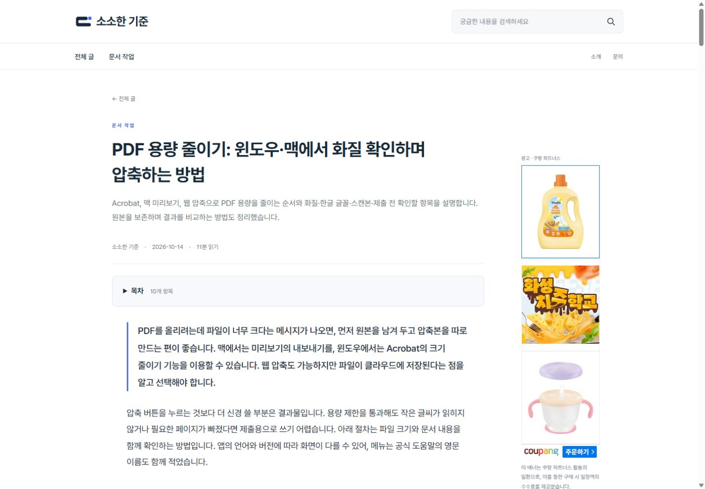
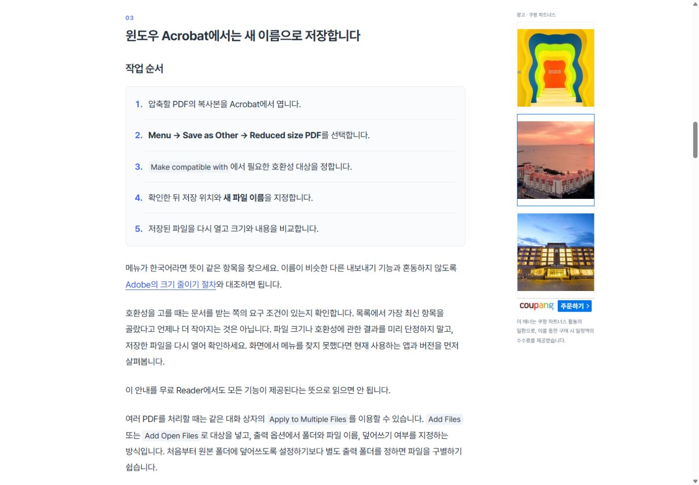
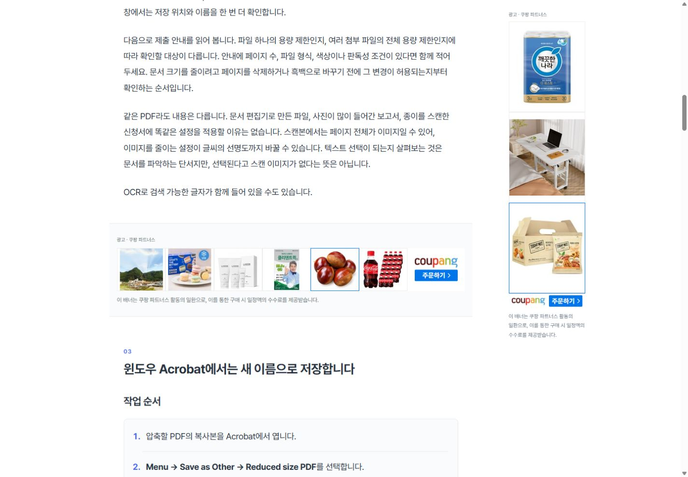
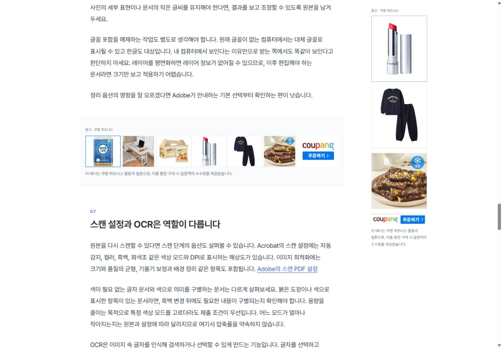
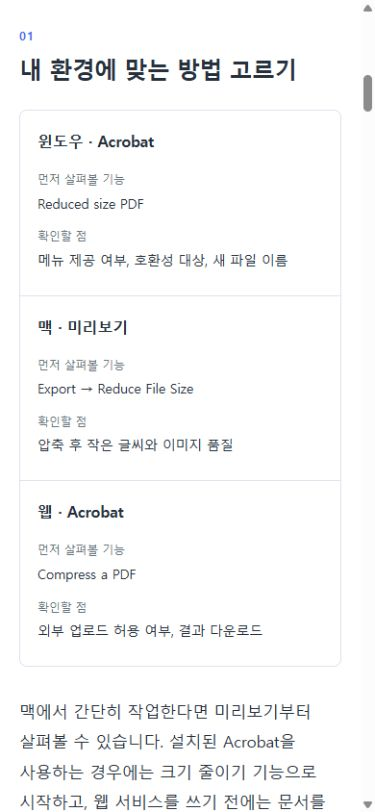
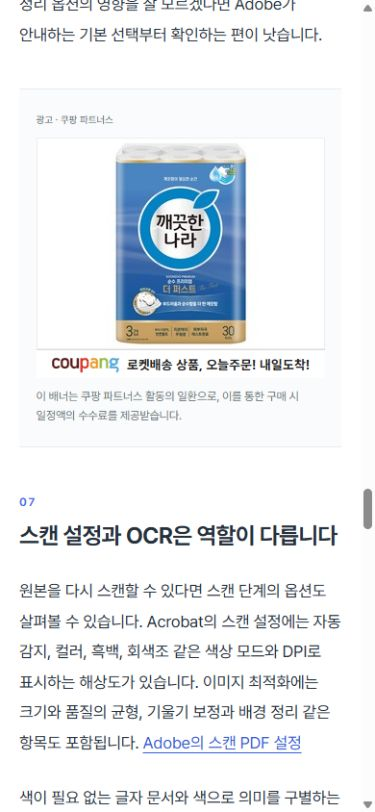
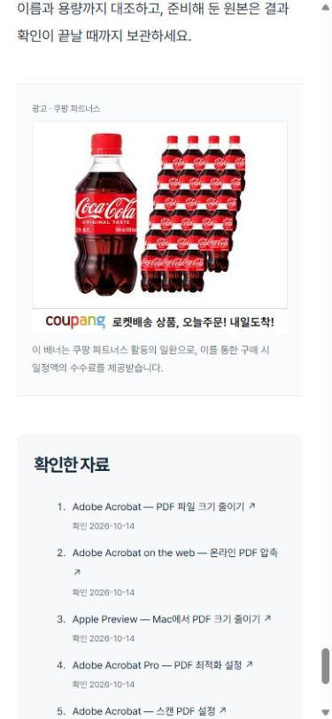

# 글 가독성과 광고 배치 개선

대상: https://lightstandards.linkingmain.workers.dev/notes/pdf-compression-20261014/

승인된 revision 3의 원고와 이미지 5장은 유지하고 표현 레이아웃을 개선했습니다. OpenAI·fal을 다시 호출하지 않았습니다. 다음 원고 생성에 적용할 프롬프트는 기존 n8n `Blog - 소소한 기준`에 저장하고 실제 저장값이 일치하는지 확인했습니다. 자동 일정은 비활성입니다.

| Before | After | Why |
| --- | --- | --- |
| 본문 폭 최대 820px, PC 17px 글자 | 본문 글줄 최대 700px, PC 18px·모바일 17px | 긴 가로 줄을 줄이고 글자를 또렷하게 표시 |
| 목차 10개가 처음부터 모두 펼쳐짐 | 기본 접힌 목차, 열기·닫기 가능한 native details | 본문 답변을 먼저 읽고 필요한 절로 이동 |
| 메뉴 경로가 일반 문단에 섞임 | 단계별 번호·구분선, 인라인 코드 배경과 읽기 편한 글꼴 | 행동 순서와 부연 설명 구별 |
| 모바일 비교표 가로 스크롤 | 2~3열 표는 항목별 세로 배치, 더 넓은 표는 키보드로 접근 가능한 스크롤 | 작은 화면에서 조건을 비교 |
| 첫 설명 뒤 큰 사진 | 첫 비교 설명을 읽은 뒤부터 사진 분산 | 답과 필요한 선택을 먼저 확인 |
| 본문 광고 1곳·PC 사이드 1곳 | 충분히 긴 글에 본문 초반·중후반·끝과 PC 사이드 | 읽는 흐름에 맞춰 노출 분산 |
| 위치를 고정 절 번호로 결정 | 완결된 절 사이, 첫 1천 자 이후·다음 광고까지 1,800자 이상 간격 | 절차 중간 삽입·인접 광고를 방지 |

## 참고와 배치 판단

Tom’s Guide의 문서 안내 글을 실제 브라우저에서 확인했습니다. 상단 가로 광고, 본문 사이 ad-unit-1·ad-unit-2, 오른쪽 광고 영역이 관찰됐습니다. 이 사이트의 팝업·하단 고정 광고·외곽 광고까지 복제하지는 않았습니다. 트래픽·광고 전환율을 측정한 사례라는 뜻은 아닙니다.

https://www.tomsguide.com/computing/macos/the-fastest-way-to-sign-documents-on-mac-is-a-secret-feature-hidden-in-plain-sight

Google의 광고 게재위치 정책에서 콘텐츠·탐색과 광고를 구분하고, 메뉴·다운로드·이동 버튼 부근의 의도하지 않은 클릭을 피해야 한다는 점도 확인했습니다. 쿠팡 배너는 자체 라벨과 배너별 수수료 안내를 유지했습니다. 이 참고가 특정 쿠팡 배치에 대한 공식 승인이나 수익 보장은 아닙니다.

https://support.google.com/adsense/answer/1346295?hl=ko

현재 글의 첫 본문 광고는 두 번째 절 뒤, 다음 광고는 여섯 번째 절 뒤이며 마지막 본문 다음에 하단 광고를 표시합니다. 사진이 붙은 절의 바로 뒤에는 중간 광고를 넣지 않습니다. PC는 728×90, 모바일은 300×250, PC 오른쪽은 160×600입니다. 화면이 좁으면 오른쪽 광고를 숨깁니다. 쿠팡 위젯은 페이지의 실제 폭으로 규격을 선택하고 뷰포트에 접근할 때 로드합니다.

짧은 글은 내부 두 곳을 강제로 채우지 않습니다. 글별 성과를 판단할 트래픽·전환 데이터는 아직 없습니다. 애드센스 광고는 기존 계정·슬롯이 구성된 경우에만 표시됩니다.

## 검증

로컬 테스트 16개와 Astro 빌드 통과. 추가 검증은 현재 발행 글의 이미지 보존·광고 간격 및 비교표 제목에서 HTML 속성이 삽입되지 않는지 확인합니다.

배포 커밋 cc624e5c815979bdfae9d4f691c8754431f9f8ed. GitHub Actions 38494531775에서 테스트·빌드·Cloudflare 배포 모두 성공했습니다.

https://github.com/KimHanWol/Web-LightStandards/actions/runs/38494531775

- PC 1440×1000: 본문 글줄 700px, 글자 18px, 가로 넘침 없음. 본문 초반·중후반·하단 모두 실제 728×90 위젯 로드, 오른쪽 실제 160×600 위젯 로드를 확인했습니다.
- 목차 열기와 윈도우 절 이동: section-3의 화면 위 위치 약 28px, 오른쪽 따라오는 배너 위 위치 24px.
- 모바일 390×844: 글자 17px, 가로 넘침 없음, 사이드 배너 숨김. 표의 세 환경을 세로 구성으로 확인했고 각 본문 광고는 실제 300×250 위젯으로 로드됐습니다.
- 이미지 5장과 원고 revision 3 유지. 원고 생성 프롬프트만 기존 비활성 n8n 본체에 저장하고 일치 여부를 확인했습니다. 추가 유료 생성 실행은 하지 않았습니다.
- 브라우저 임시 뷰포트 설정과 참고·검증용 탭은 정리했습니다. 광고·상품 링크를 클릭하지 않았습니다. 화면을 옮기기 위해 일반 수수료 안내 텍스트를 선택한 것은 구매·광고 클릭이 아닙니다.

