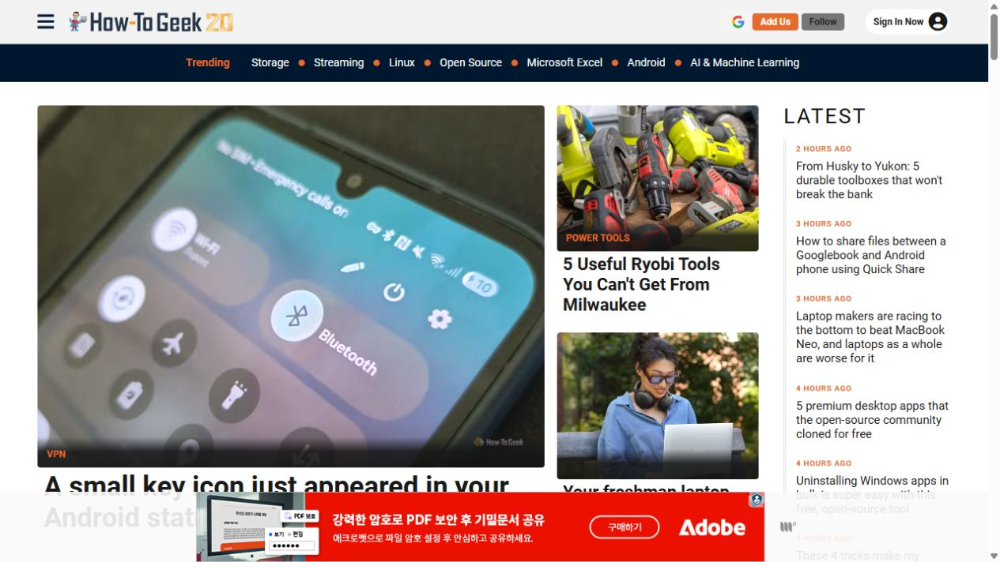
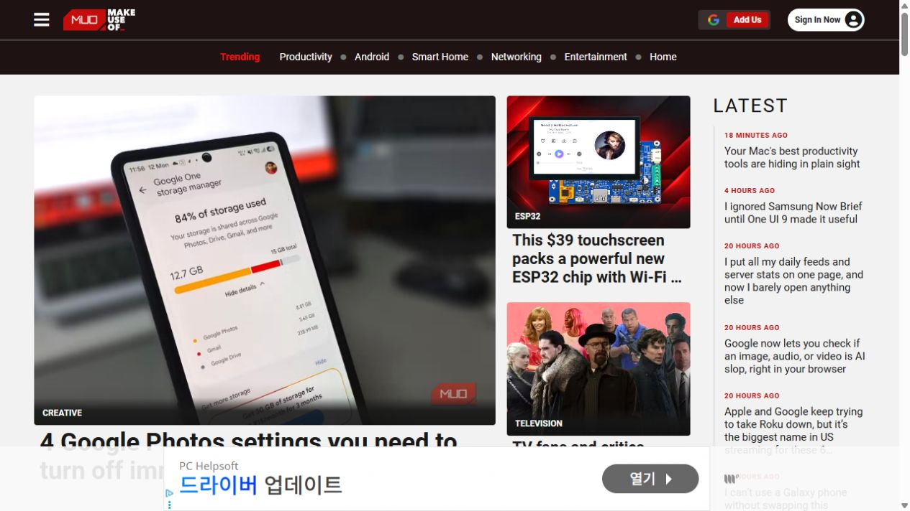
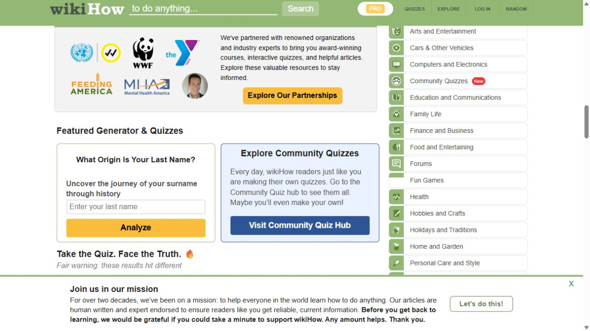
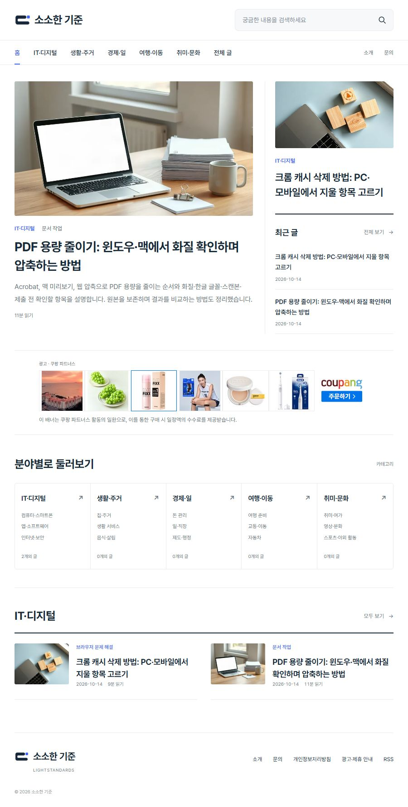
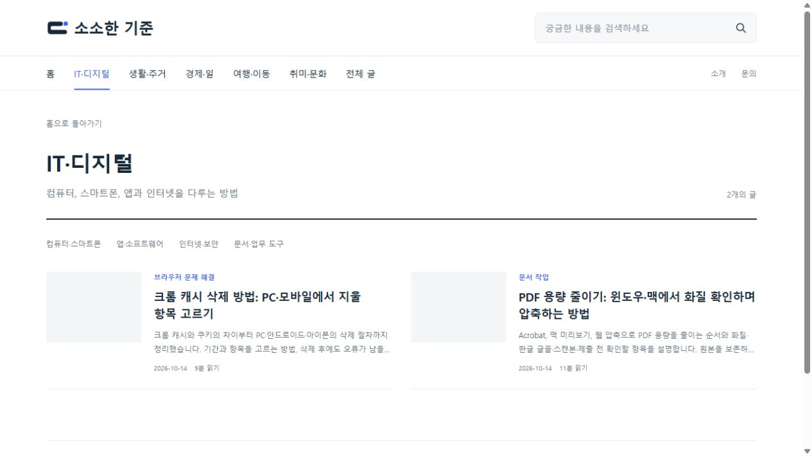
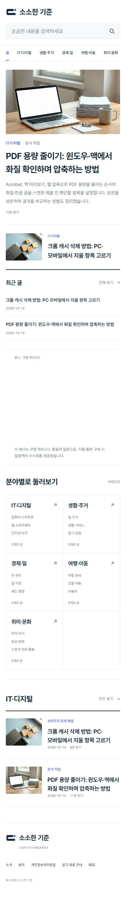

# 참고 사이트 기반 홈페이지 구성

확인일: 2026-10-14. 실제 브라우저에서 How-To Geek, MakeUseOf, wikiHow의 홈을 확인하고 필요한 레이아웃·메뉴 정보를 기록했습니다. 다른 사이트의 기사·사진·브랜드 자산을 사이트 콘텐츠로 가져오지 않았습니다.

## 참고 사이트와 규모

| 사이트 | 구조 출처 | 트래픽 근거 | 적용 |
| --- | --- | --- | --- |
| How-To Geek | https://www.howtogeek.com/ | [운영사 Valnet](https://www.valnetinc.com/en/technology): 2026년 4월 기준 월 방문 1,200만·월 페이지뷰 1,400만 | 주요 글·보조 글·최신 목록의 구분, 큰 분야 아래 세부 메뉴, 분야별 콘텐츠 영역 |
| MakeUseOf | https://www.makeuseof.com/ | 같은 Valnet 자료: 2026년 4월 기준 월 방문 800만·월 페이지뷰 900만 | 주요 글과 최신 글 목록의 동시 노출, 큰 분야·세부 주제 계층과 독립적인 글 모음 |
| wikiHow | https://www.wikihow.com/Main-Page | 최신 월 방문 수는 이번 검토에서 공식 자료로 확인하지 못했습니다. 범용 분류의 참고 자료로 사용 | 컴퓨터·전자, 집·정원, 금융·사업, 일, 여행, 여가 등을 묶는 분야 디렉터리 |

트래픽 수치는 운영사가 공개한 해당 시점 수치입니다. 지금의 실시간 방문 수·한국어 독자 규모·광고 수익은 확인한 값이 아닙니다. 이 구조가 높은 트래픽의 원인이라는 인과관계를 주장하지 않습니다.

wikiHow의 실제 카테고리 링크 예:

- [컴퓨터·전자](https://www.wikihow.com/Category:Computers-and-Electronics)
- [집·정원](https://www.wikihow.com/Category:Home-and-Garden)
- [금융·사업](https://www.wikihow.com/Category:Finance-and-Business)
- [일](https://www.wikihow.com/Category:Work-World)
- [여행](https://www.wikihow.com/Category:Travel)
- [여가](https://www.wikihow.com/Category:Hobbies-and-Crafts)

## 적용한 분류와 레이아웃

한국어 분류는 원본 메뉴를 그대로 번역한 것이 아니라 참고 구조를 바탕으로 정리한 설계입니다. 사용자가 이번에 명시적으로 참고 사이트 기반 카테고리 생성을 요청한 범위 안에서 구성했습니다.

| 큰 분야 | 세부 주제 예시 | 현재 실제 글 |
| --- | --- | --- |
| IT·디지털 | 컴퓨터·스마트폰, 앱·소프트웨어, 인터넷·보안, 문서·업무 도구 | PDF 압축, Chrome 캐시 삭제 |
| 생활·주거 | 집·주거, 생활 서비스, 음식·살림 | 없음 |
| 경제·일 | 돈 관리, 일·직장, 제도·행정 | 없음 |
| 여행·이동 | 여행 준비, 교통·이동, 자동차 | 없음 |
| 취미·문화 | 취미·여가, 영상·문화, 스포츠·야외 활동 | 없음 |

빈 분야에 원고·인기·조회 수를 만들어 채우지 않습니다. 해당 카테고리는 정상적인 빈 상태를 제공하고 noindex로 처리하며 사이트맵에서 제외합니다. 원고의 실제 세부 category와 승인 revision은 유지하고 탐색용 큰 분야만 매핑합니다. 새 주제의 분류를 이 다섯 분야로 강제하지 않고 미분류 글은 기타 정보로 표시합니다.

홈 상단은 작성 시점 순서와 독립적으로 선택한 주요 글(PDF)과 보조 글(Chrome)을 보여 줍니다. 오른쪽 최근 글 목록은 실제 발행 시점 순입니다. 중간 배너는 주요 글과 분야 탐색 사이의 독립된 광고 영역이며 기존 배너 수수료 안내를 유지합니다. 그 아래 분야 디렉터리와 실제 글이 있는 분야의 목록을 구성했습니다. 검색·전체 글은 별도 목록 보기로 분리했습니다.

| Before | After | Why |
| --- | --- | --- |
| 실제 글 두 편의 제목을 주제 카드로 반복 | 다섯 큰 분야와 실제 세부 주제, 카테고리별 페이지 | 원고 제목과 탐색 분류를 구분 |
| 최신 글이 중심인 목록 | 주요·보조 글과 최근 목록, 분야별 글 영역 | 발행 날짜 외의 탐색 경로 제공 |
| 인기 사이트 참고 근거가 없음 | 세 사이트의 실제 화면·메뉴와 운영사 규모 자료 기록 | 적용한 구성의 근거를 검토 가능하게 |

참고 사진은 검토 기록이며 서비스에 쓰는 이미지 자산이 아닙니다.

## 공개 배포 검증 — 2026-10-15

커밋 6a39448c0076f0e286d0f15a522b16b82dd0f4c7, GitHub Actions 38585269599 배포 성공. PC 1280px 및 모바일 390×844px에서 본문 가로 넘침 없음. 모바일 주 메뉴는 자체 가로 스크롤이며 본문은 한 열입니다. 기본 홈 주요 글은 PDF, 보조 글은 Chrome이며 최근 목록은 실제 발행일 순입니다. IT·디지털 허브의 실제 글 2편, 글이 없는 분야의 빈 상태와 noindex 처리, 홈페이지 전체 글 2편 및 별칭 검색 결과 1편을 확인했습니다. 카테고리 5개 모두 HTTP 200. 사이트맵은 실제 글이 있는 digital 허브만 포함하고 빈 허브는 제외합니다. 원고 승인 revision은 PDF 3·Chrome 4를 유지합니다.

홈 중간 배너의 공식 쿠팡 iframe과 loaded 상태 및 실제 표시를 확인했습니다. 새 홈을 공개 브라우저에 남겼고 임시 모바일 뷰포트는 복원했습니다. 참고용 브라우저 탭은 정리했습니다.

