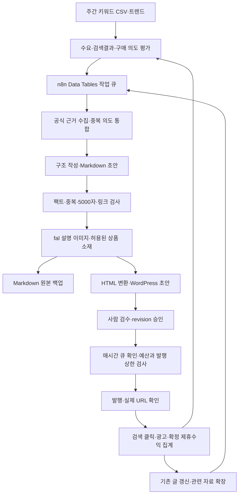

# 검색 유입을 수익으로 연결하는 블로그 자동화 설계

**추천 기본안은 ‘자체 도메인 + 관리형 WordPress + n8n + Markdown 원본 보관’이다.** 한국어 콘텐츠로 한국 독자를 대상으로 시작한다는 가정이다. 자체 사이트는 광고 배치, 상품 링크, 분석, 콘텐츠 이전을 직접 통제할 수 있어 이번 목적에 적합하다. 다만 네이버보다 처음부터 유입이나 수익이 크다는 뜻은 아니다. 가장 중요한 설계는 매시간 글을 무조건 공개하는 것이 아니라, **검색 수요와 자료가 확인되고 검수를 통과한 글만 매시간 발행 큐에서 꺼내는 것**이다. 초기에는 한 분야에서 하루 1~3편 이하로 운영하고, 실제 검색 클릭과 확정 수익이 쌓이는 주제에 생산량을 늘린다. 글당 5,000자와 fal 이미지는 제작 규격으로 반영하되, 분량이나 생성 이미지 자체를 SEO·광고 승인 조건으로 취급하지 않는다.

조사 기준은 **2026년 10월 12일**이다. 아래 정책·기능은 공식 자료로 확인했고, 운영 수치와 예산은 별도로 표시한 설계 가정이다. 사용자의 광고 계정이나 실제 키워드 검색량에 접근하지 않았으며, 사이트 개설·워크플로 생성·유료 실행은 하지 않았다.

## 자체 사이트를 본진으로 두고 편집은 WordPress에서 처리한다

이번에는 화면부터 직접 개발하는 홈페이지보다 **관리형 WordPress에 가벼운 테마를 적용하는 방식**이 적합하다. 관리자가 초안을 읽고 수정하고 예약하는 화면이 이미 있으므로, 승인 대시보드나 CMS를 따로 만들 필요가 적다. 광고 코드 삽입과 REST API 접근을 허용하고 백업·복구를 제공하는 호스팅을 고른다. SEO 플러그인 하나부터 시작하고, 호스팅에 있는 캐시·백업 기능을 플러그인으로 중복 구성하지 않는다. 이는 운영 편의를 위한 선택이며 WordPress가 다른 플랫폼보다 높은 순위나 광고 수익을 보장한다는 의미는 아니다.

강의에서 본 Markdown 업로드 구조는 충분히 구현할 수 있다. **원본은 Markdown으로 저장하고, 게시할 때 n8n에서 HTML로 변환하여 WordPress REST API에 전달**하면 된다. n8n에는 Markdown 변환 노드와 WordPress 글 생성·수정 노드가 있고, REST API는 초안·예약·공개 상태와 대표 이미지 등을 지원한다. Markdown은 제작·보관 형식이고 방문자가 읽는 것은 최종 HTML이다. ([n8n Markdown](https://docs.n8n.io/integrations/builtin/core-nodes/n8n-nodes-base.markdown/), [n8n WordPress](https://docs.n8n.io/integrations/builtin/app-nodes/n8n-nodes-base.wordpress/), [WordPress Posts API](https://developer.wordpress.org/rest-api/reference/posts/))

| 선택지 | 이번 목적에 맞는 장점 | 추가로 관리할 부분 | 판단 |
|---|---|---|---|
| 관리형 WordPress | 초안 검수·수정·예약, 광고·상품 카드 관리 | 호스팅, 업데이트, 플러그인 최소화 | **초기 기본안** |
| Astro + Markdown + Git | 파일 보관·버전 관리, 정적 페이지 배포 | 편집 화면, 예약, 빌드 실패, 이미지·배포 관리 | 실제 `.md` 파일 중심 운영을 강하게 원할 때 |
| 네이버 블로그 | 네이버 안에서 독자를 만나는 별도 채널 | 플랫폼 정책과 편집 제약, 별도 콘텐츠 운영 | 필요할 때 보조 채널로 검증 |

Astro는 Markdown 컬렉션과 스키마를 지원해 파일 중심 자동화에 잘 맞는다. 다만 쉬운 세팅과 유지보수가 우선이면 WordPress보다 직접 처리할 작업이 늘어난다. 사이트가 성장한 뒤 옮길 수 있도록 원본과 이미지 출처를 CMS 밖에도 보관한다. ([Astro content collections](https://docs.astro.build/en/guides/content-collections/))

네이버는 공식 수익화 수단인 애드포스트를 중심으로 판단해야 한다. 네이버 블로그 글쓰기 Open API는 2020년에 종료됐으며, 공개 운영정책에도 사전 허락 없는 자동화 수단으로 기계적인 패턴 글을 반복 게시하는 행위에 대한 제한이 있다. 따라서 네이버 브라우저 자동발행을 핵심 인프라로 삼는 설계는 권하지 않는다. 필요하면 실제 경험이나 별도로 편집한 내용을 올리는 채널로 시험하고, 자체 사이트와 성과를 비교한다. ([네이버 글쓰기 API 종료 공지](https://developers.naver.com/notice/article/7527), [네이버 운영정책](https://notice.naver.com/api/v1/file/download/122), [애드포스트 설정](https://help.naver.com/service/5593/contents/15308?lang=ko&osType=PC))

전체 구조는 다음 정도면 충분하다. 아래 명칭은 논리 단계이며 실제 n8n 워크플로 이름이 아니다.

## 검색량보다 실제 클릭을 확보할 수 있는 주제부터 고른다

사용자가 말한 도구는 **Google Ads 키워드 플래너**로 보면 된다. 월 검색량 추정치와 키워드 제안을 제공하지만, 현재 안내상 접근하려면 계정 설정과 결제 정보 입력이 필요하다. 이번 조사에서는 사용자의 계정 접근 가능 여부나 제공되는 검색량 정밀도를 확인하지 않았다. 처음에는 키워드 플래너와 네이버 키워드 도구의 CSV를 가져와 주 1회 갱신하는 방식이 가장 단순하다. 매시간 검색량을 다시 조회할 이유는 없다. ([키워드 플래너 시작하기](https://support.google.com/google-ads/answer/7337243?hl=en))

여기서 **키워드 플래너의 Competition은 광고주 경쟁도이고, 검색 결과에서 글이 상위에 오르기 어려운 정도가 아니다.** 상단 입찰가도 광고주가 검색광고에 지불하는 비용 지표다. 이 값을 블로그의 AdSense RPM으로 바꾸어 수익을 계산하면 안 된다. 검색량은 지역·기간·네트워크·유사 변형의 영향을 받으며, 네이버와 구글 수치를 합쳐 실제 방문자 수라고 볼 수도 없다. Google Trends와 네이버 데이터랩의 0~100 값 역시 절대 검색수가 아닌 상대 지표다. ([키워드 플래너 측정항목](https://support.google.com/google-ads/answer/3022575?hl=en), [Google Trends 데이터](https://support.google.com/trends/answer/4365533?hl=en), [네이버 데이터랩](https://developers.naver.com/docs/serviceapi/datalab/search/search.md))

초기 후보 200~500개를 모은 뒤 같은 검색 의도를 묶는다. ‘USB-C 허브 추천’처럼 넓은 단어만 보는 대신 ‘어떤 노트북에서 모니터 두 대를 연결할 때 필요한 포트 조건’처럼 사람의 상황과 결정이 드러나는 질문을 찾는다. 상위 10개 결과를 표본 확인해 공식 사이트·쇼핑·영상이 차지하는 위치, 의도 충족 정도, 최신성, 비교표와 실제 근거의 수준을 기록한다. **경쟁 블로그 수보다 우리가 추가할 수 있는 정보의 구체성이 중요하다.** 검색 결과에서 한 줄로 해결되는 질문보다 호환표·계산기·조건별 비교·상세 사진을 직접 확인할 이유가 있는 페이지를 우선한다. 이는 클릭 가능성을 높이기 위한 가설이며, 현재 특정 키워드의 저경쟁이나 고수익이 검증됐다는 뜻은 아니다.

| 검증할 주제 후보 | 트래픽을 만들 질문 | 구매로 연결할 자료 | 비용·정확성 문제 |
|---|---|---|---|
| 생활가전 소모품·관리 | 모델별 필터·부품 선택과 관리 | 제조사 자료를 확인한 호환표, 직접 촬영 | 모델 오류·노후 정보 관리, 위험한 수리 제외 |
| PC 주변기기·작업 환경 | 연결 조건·호환성·설치 문제 | 케이블·허브·거치대 비교, 실제 조합 확인 | 포트 사양 혼동 방지, 근거 확보 |
| 소형 주거 수납 | 치수·문 열림·공간 조건별 선택 | 실측 도면·수납 계산기·치수표 | 흔한 추천 목록과 차별화 필요 |
| 특정 취미의 장비·관리 | 입문 단계·소모품·관리법 | 직접 만든 체크리스트와 시험 결과 | 실제 경험과 촬영 가능한 분야 선택 |

**이 표는 검증 전 후보이지 검색량 순위표가 아니다.** 첫 분야는 사용자가 실제 장비·자료·경험을 확보할 수 있는 한 개로 좁히는 편이 좋다. 저비용 운영을 원하므로 전문 검토와 잦은 갱신이 필요한 의료·금융·법률 분야를 광고 단가만 보고 고르지 않는다. 같은 분야 안에서 문제 해결 글로 유입을 모으고, 선택·비교·호환 페이지로 내부 연결한다. 모든 정보 글에 상품을 억지로 끼워 넣기보다 구매 판단에 도움이 되는 위치에 제휴 링크를 둔다.

첫 점수표는 수요 25점, 유기 검색 결과의 빈틈 25점, 클릭할 필요성 15점, 구매 연결성 20점, 직접 근거를 만들 수 있는 정도 15점으로 둘 수 있다. 제작·갱신 비용과 오류 위험은 별도 감점한다. 이는 **내부 선별용 임시 규칙**이며 수익 예측 공식이 아니다. 클릭 데이터가 쌓이면 실제 유입이 잘 생기는 특성에 맞춰 가중치를 바꾼다.

GEO도 같은 기반에서 운영한다. 검색이 읽을 수 있는 본문, 명확한 답, 확인 가능한 출처, 작성·갱신일, 본문과 일치하는 구조화 데이터가 우선이다. Google의 최신 안내는 특별한 Markdown 형식이나 `llms.txt`, 전용 구조화 데이터를 요구하지 않는다. 2026년에는 Search Console의 생성형 AI 성과 보고서도 제공되므로 **AI 노출, 전체 검색 클릭, 실제 사이트 방문과 수익을 따로 기록**한다. AI 노출이 곧 방문은 아니며 Google 보고서가 모든 AI 서비스의 노출을 대표하지도 않는다. ([Google AI 최적화 가이드](https://developers.google.com/search/docs/fundamentals/ai-optimization-guide), [생성형 AI 성과 보고서 발표](https://developers.google.com/search/blog/2026/06/gen-ai-performance-reports))

API 연동은 성과 확인 뒤 진행한다. Google Ads API의 접근·인증 체계는 최근 바뀌었고 키워드 Planning 서비스에는 별도 접근 수준과 허용 용도 확인이 필요하므로, 오래된 튜토리얼대로 토큰을 만들면 바로 된다고 가정하지 않는다. MVP에서는 정당하게 내보낸 CSV가 충분하다. ([현재 API 접근 수준](https://developers.google.com/google-ads/api/docs/api-policy/access-levels), [인증 변경 안내](https://developers.google.com/google-ads/api/docs/api-policy/developer-token))

## 광고 승인의 핵심은 AI 여부보다 콘텐츠 가치와 편집 체계다

‘요즘 AI 블로그는 광고 승인을 거의 안 해준다’는 주장에 대해, 이번 조사에서는 한국 AI 블로그 승인률이나 과거 대비 하락 폭을 보여 주는 신뢰할 공식 통계를 확보하지 못했다. 확인된 것은 AdSense가 독창적이고 품질 있는 콘텐츠를 요구하고, 게시자 콘텐츠가 없거나 가치가 낮은 화면에는 광고를 허용하지 않는다는 점이다. 해당 정책 설명의 팁에는 **수동 검토 또는 큐레이션 없이 자동 생성 콘텐츠에 광고를 배치하지 말라**는 안내가 있다. AI 사용을 일괄 금지한다거나 모든 문장마다 특정 승인 버튼이 의무라는 규칙으로 확대 해석하면 안 된다. ([AdSense 자격](https://support.google.com/adsense/answer/9724), [저가치 콘텐츠 정책과 설명](https://support.google.com/publisherpolicies/answer/11112688))

검색과 광고도 구분해야 한다. 검색 순위를 조작하려는 목적으로 독자에게 별 가치 없는 페이지를 대량 생성하면 Google의 대규모 콘텐츠 악용 정책 대상이 된다. 사용 도구가 AI인지 사람인지보다 목적과 가치가 기준이다. **5,000자·매시간 발행·이미지 두 장은 검색이나 AdSense 승인을 보장하지 않는다.** Google은 선호 글자 수가 없다고 명시한다. 따라서 장문이 필요한 비교·선택·문제 해결 주제만 큐에 넣고, 얇은 질문을 반복 문장으로 늘려야 한다면 기존 안내서에 합치거나 보류한다. ([Google 검색 스팸 정책](https://developers.google.com/search/docs/essentials/spam-policies), [사람 중심 콘텐츠 안내](https://developers.google.com/search/docs/fundamentals/creating-helpful-content))

실제 차별점은 공식 문서들을 나열하는 것을 넘어 **독자 조건에 맞춘 호환표, 직접 측정, 계산 도구, 확인된 장단점과 선택 기준**에 둔다. 사용하지 않은 물건을 써 봤다고 쓰거나 출처 없는 비교 점수를 만들지 않는다. 소개·운영자·문의·개인정보·편집 원칙과 제휴 공개를 갖추고, 비어 있는 태그·검색 결과·초안 화면에는 광고를 넣지 않는다. 이는 운영 권고이며 ‘몇 개 페이지와 몇 편 글이면 승인된다’는 공식은 아니다. 실제 경험과 정량 근거를 중시하는 Google 리뷰 안내도 이런 방향을 뒷받침한다. ([좋은 리뷰 작성 안내](https://developers.google.com/search/docs/specialty/ecommerce/write-high-quality-reviews))

쿠팡 파트너스는 상품·계정 조건을 반영해야 한다. 확인한 공식 가이드에는 기본 수수료 3%, 일부 스마트폰 1%, 제외 상품과 별도 요율 가능성이 있으며 24시간 귀속, 마지막 유입 링크, 취소·반품 차감 등이 설명돼 있다. API와 정산은 최종승인 이후이고, 누적 판매금액 15만원부터 최종승인 검토가 안내된다. 따라서 초기 자동화가 이미 API를 쓸 수 있다고 가정하지 않고 수동 생성한 제휴 링크를 구조화 데이터로 입력할 수 있게 한다. 구현 직전 실제 계정의 최신 요율·약관을 확인한다. ([쿠팡 공식 이용가이드](https://partners.coupangcdn.com/partners-guide/partners-guide-20260611145240.pdf), 16·19·41~44쪽)

제휴 글의 제목이나 첫 부분에는 경제적 관계를 명확히 공개한다. 템플릿 기본 문구는 **“이 게시물은 쿠팡 파트너스 활동의 일환으로, 이에 따른 일정액의 수수료를 제공받습니다.”**로 두고, 제휴 링크에 `rel="sponsored"`를 적용한다. 가격·재고·최저가를 LLM이 추측해서 쓰지 않게 하고 상품 데이터 확인일을 남긴다. ([쿠팡 공식 이용가이드](https://partners.coupangcdn.com/partners-guide/partners-guide-20260611145240.pdf), 62쪽; [Google 링크 정책](https://developers.google.com/search/docs/essentials/spam-policies))

fal은 설명용 일러스트나 공간 예시를 만드는 데 사용한다. 실제 제품의 외형·성능·사용 결과를 생성해서 실물 리뷰 증거처럼 제시하지 않는다. 상품 사진은 사용권이 확인된 공식 소재나 직접 촬영본을 쓰고, 각 이미지에 출처·권리 확인일·생성 여부를 저장한다. 가격·수치·비교표는 이미지 속 글자로 만들지 않고 HTML로 출력하면 수정과 검증이 쉽다. 글당 설명 이미지 1~2장을 기본으로 하되 실제 이해에 도움이 되는 위치에만 넣는다.

## n8n은 초안 생성보다 상태·검수·중복 방지를 먼저 설계한다

초기 데이터 저장은 기존 n8n의 Data Tables로 충분한지 확인한다. 키워드, 작업 상태, 출처 요약, 원본 파일 참조, 게시 ID, 비용을 저장하고 이미지 바이너리나 수집한 페이지 전체를 넣지 않는다. Data Tables는 지속 저장과 중복 방지 마커 용도로 제공되는 경량~중간 규모 저장 기능이다. Markdown과 버전별 JSON은 비공개 저장소나 백업에 보관한다. 여러 작업자가 동시에 작업을 가져가야 하는 규모가 되면 트랜잭션 처리가 가능한 데이터베이스로 옮긴다. 첫 버전부터 별도 DB·Redis·벡터 검색을 모두 넣을 필요는 없다. ([n8n Data Tables](https://docs.n8n.io/build/work-with-data/data-tables.md))

| 데이터 묶음 | 최소 저장 항목 |
|---|---|
| 키워드 | 검색어, 의도 군집, 엔진·국가·기간, 검색량 또는 범위, 출처·조회일, 광고 경쟁도, 실제 결과 검토, 클릭·구매 가능성 |
| 원고 | article_id, revision, intent_key, 제목, slug, Markdown 원본 참조, 본문 문자 수, 출처와 뒷받침하는 주장 |
| 이미지·상품 | 생성 여부, 소재 출처·권리 확인일, 모델·request_id, CMS media_id, alt, 상품 링크·정보 확인일 |
| 검수·게시 | 상태, 승인자·시각·승인 revision, CMS post_id, 게시 URL, 마지막 오류 |
| 원가·성과 | 전체 토큰·이미지·데이터 비용, 검수 시간, 검색 클릭, 방문, 제휴 클릭, 확정 수수료, 광고 수익 |

처리 상태는 `candidate → researched → drafted → qa_passed → human_approved → scheduled → published`로 두고, 예외는 `needs_review` 또는 `failed`로 보낸다. 근거 수집이 끝나기 전에는 장문을 만들지 않고, 본문 검사 전에는 이미지 비용을 쓰지 않는다. 분류·개요·중복 검사는 저렴한 모델을 사용하고 모순 해결이 필요한 일부 작업만 상위 모델로 보낸다. 모델끼리 점수를 주고받는 결과만으로 사실 검증을 완료하지 않는다.

본문 검사는 근거 없는 수치, 가짜 경험, 제품명·모델명 오류, 제목과 본문 불일치, 기존 글과 의도 중복, 링크와 Markdown 구조를 확인한다. **5,000자는 렌더링한 본문 텍스트의 Unicode 문자 수로 검사**하고 공백 포함·제외 수치를 모두 기록한다. 초깃값은 공백 포함 5,000자 이상으로 두되 HTML 태그, frontmatter, 이미지 URL, 반복 공개 문구로 분량을 채우지 않는다. 실제 상품 주장과 숫자는 출처에 연결돼 있어야 한다.

fal 요청은 비동기 큐에 제출하고 `request_id`를 저장한다. 결과 이미지는 WordPress Media에 보관하고 대체 텍스트·크기·캡션을 정리한다. 임시 결과 URL을 영구 이미지 주소처럼 사용하지 않는다. 이어 Markdown을 HTML로 바꾸고 허용된 태그·속성만 남겨 초안으로 등록한다. 외부 자료나 모델이 만든 임의 스크립트는 본문에 넣지 않으며, 광고 코드는 관리자가 정한 사이트 템플릿에서 적용한다. ([fal 비동기 큐](https://fal.ai/docs/documentation/model-apis/inference/queue), [WordPress Media API](https://developer.wordpress.org/rest-api/reference/media/))

운영자는 하루 1~2번 초안을 묶어서 실제 미리보기로 읽는다. 근거·차별점·제휴 표기·이미지·모바일 가독성을 확인하고 승인한 원고 버전을 기록한다. 승인 이후 내용이 바뀌면 다시 검수 상태로 돌린다. 매시간 스케줄은 Asia/Seoul 기준으로 승인 큐와 일일·월간 상한을 확인해 한 편을 처리한다. 적격 글이 없으면 아무것도 공개하지 않는다. 초기 하루 1~3편은 운영 실험 범위이지 검색엔진이 정한 안전 수치가 아니다. 예약 발행을 WordPress에 맡기면 호스팅의 cron 동작과 누락 감지를 확인한다.

중복 방지 키는 `intent_key + revision + action`으로 만들고 **게시 작업자는 하나부터 운영**한다. Data Tables가 원자적 잠금을 보장한다고 가정하지 않는다. 게시 응답이 끊기면 저장한 post_id나 결정적 slug로 기존 글을 조회한 뒤 수정하며, 처음부터 다시 생성하지 않는다. fal도 저장한 request_id 상태를 먼저 조회해 중복 과금을 줄인다. 요청 접수 여부를 모르는 경우에는 확인 큐로 보낸다. 429·5xx 같은 일시 오류는 제한된 재시도로 처리하고 인증·입력 오류는 중단한다. 초깃값은 재시도 2회, 이미지 재생성 1회, 원고별·일별·월별 비용 상한이다.

게시 뒤에는 실제 URL 응답, 본문·대표 이미지, canonical, noindex 상태를 확인한다. 게시 성공은 검색 색인 성공과 별개다. 자격 증명은 n8n credential store에 보관하고 WordPress에는 필요한 권한의 전용 계정과 Application Password를 사용한다. Markdown·작업 테이블·WordPress DB와 미디어를 함께 백업하고 복구를 확인한다. ([WordPress REST 인증](https://developer.wordpress.org/rest-api/using-the-rest-api/authentication/))

## 월 60편으로 원가를 측정한 뒤 수익이 확인되는 군집만 늘린다

생성 원가가 낮아도 글이 유입을 만들지 못하면 이익은 없다. 운영 지표의 우선순위는 **실제 검색 클릭과 방문 → 방문당 확정 수익 → 제작·검수·갱신 총원가**다. 글 수나 AI 노출수는 보조 지표로 둔다. 한 분야의 3~5개 의도 군집에 서로 다른 자료 20~40편을 단계적으로 발행한다. 첫 2~4주는 기술·품질·제작 원가를 확인하고, 검색 성과는 8~12주 이상 관찰할 계획을 세운다. 이는 운영 일정 가정이며 성과가 나오는 기한을 보장하지 않는다. 월 60편은 초기 처리 용량 예시이고 반드시 채울 목표가 아니다. 초기 무클릭만으로 글을 바로 삭제하지 않으며, 정보형 글의 검색 유입과 구매형 글의 제휴 성과를 함께 비교한다.

다음 비용표는 **견적이나 현재 특정 LLM 가격이 아닌 계산용 시나리오**다. 글당 전체 단계 합산 입력 20,000토큰·출력 10,000토큰, 가상 단가 입력 $0.25/100만·출력 $1.50/100만이면 텍스트 비용은 $0.020/편이다. 5,000 한글 문자와 토큰 수는 다르므로 실제 10~20편의 사용량으로 바꿔야 한다. fal `flux/schnell` 공식 표시는 $0.003/MP이며 메가픽셀을 올림 청구한다. 아래는 1024×768 이미지 두 장을 각각 1MP로 청구하는 전제다. 다른 모델·해상도·재생성 비용은 달라진다. ([fal 모델 가격](https://fal.ai/models/fal-ai/flux/schnell))

| 항목 | 월 60편 | 월 720편: 30일간 매시간 1편 |
|---|---:|---:|
| 텍스트: 가상 단가·사용량 적용 | $1.20 | $14.40 |
| fal: 편당 1MP 청구 이미지 2장 | $0.36 | $4.32 |
| 관리형 WP: 예산 가정 | $15.00 | $15.00 |
| 도메인 월 환산: 예산 가정 | $1.50 | $1.50 |
| 기존 n8n 인프라 배분: 예산 가정 | $10.00 | $10.00 |
| 검색·SERP 데이터: 동일 예산 가정 | $20.00 | $20.00 |
| 재시도·기타 예비비: 예산 가정 | $5.00 | $5.00 |
| **예시 월 합계** | **$53.06** | **$70.22** |
| 검수 시간: 편당 5분이라는 가정 | **5시간** | **60시간** |

검색 비용은 실제 공급자·조회량에 따라 달라지며, CSV 중심 시작이면 줄일 수 있다. 반대로 호스팅에 포함되지 않는 저장·트래픽, 상용 플러그인, 세금·환율과 사람의 노동비는 위 표에 빠져 있다. 편당 검수 10분이면 720편은 120시간이다. 따라서 **생성 비용보다 검수와 갱신 시간을 먼저 감당할 수 있어야 한다.**

기존 n8n 대신 Cloud를 새로 도입하면 위 $10 배분 가정을 실제 요금으로 교체한다. 조사 시점 Starter는 연간 결제 기준 월 €20·2,500회 실행이다. 720개 초안 생성 + 720개 이미지 완료 콜백 + 720개 시간별 게시 점검이면 이미 2,160회이며, 이미지 콜백을 두 번씩 받으면 2,880회다. 연구·검수 이벤트·오류 재시도도 있으므로 ‘한 시간에 한 번이니 최소 플랜으로 충분하다’고 단정할 수 없다. 실제 실행 단위와 계측으로 계획한다. ([n8n 가격](https://n8n.io/pricing/))

광고 수익은 `페이지뷰 ÷ 1,000 × 실제 Page RPM`, 제휴 수익은 `제휴 클릭수 × 유효 구매 전환율 × 평균 확정 수수료`로 계산한다. Page RPM은 AdSense의 페이지뷰 대비 수익 지표이며 검색광고 CPC와 다르다. 쿠팡 취소·반품과 요율 예외는 확정 수수료에 반영한다. ([AdSense Page RPM](https://support.google.com/adsense/answer/112030?hl=en-GB))

예시 월비용 $70.22를 광고만으로 충당한다고 가정할 때, **가상의 Page RPM**이 $2·$5·$10이면 각각 월 35,110·14,044·7,022PV가 필요하다. 이는 예상 RPM이나 도달 가능한 유입의 예측이 아니다. 검수 노동비를 넣으면 필요한 유입이 늘고, 실제 제휴수익이 생기면 광고만으로 필요한 PV는 줄어든다. 방문이 많은 페이지와 구매에 가까운 페이지를 연결하고 광고가 상품 비교·링크 클릭을 방해하는지도 살펴본다.

주간 점검에서는 검색 노출은 늘지만 클릭이 낮으면 제목·검색 의도·검색 결과 화면을 보고, 방문은 늘지만 상품 클릭이 적으면 구매 연결성을 본다. 상품 클릭은 늘지만 확정 수익이 적으면 제품·판매 조건·전환 지연을 점검한다. 같은 의도의 글을 여러 개 만드는 대신 성과가 확인된 페이지의 자료를 보강한다. 페이지와 의도 군집 단위로 28일·90일 성과를 비교하고, 신규 사이트의 관찰 기간 부족과 제휴 정산 지연을 표시한다. 개별 페이지에 수익을 정확히 귀속할 수 없는 데이터는 군집 단위로 집계한다.

다음 설계 단계에서 결정할 것은 **월 현금 예산, 기존 도메인·호스팅·n8n 환경, 실제 자료를 확보할 수 있는 첫 주제, 하루 검수 가능 시간**이다. 이 네 가지를 기준으로 첫 키워드 CSV와 10~20편의 샘플 제작 원가를 연결하면 플랫폼과 모델 선택도 구체화된다. 처음부터 최다 발행량을 확보하기보다, 검색에서 방문할 이유가 있는 자료를 반복해서 만들고 갱신할 수 있는 구조를 먼저 확보하는 것이 이 사업의 핵심이다.
